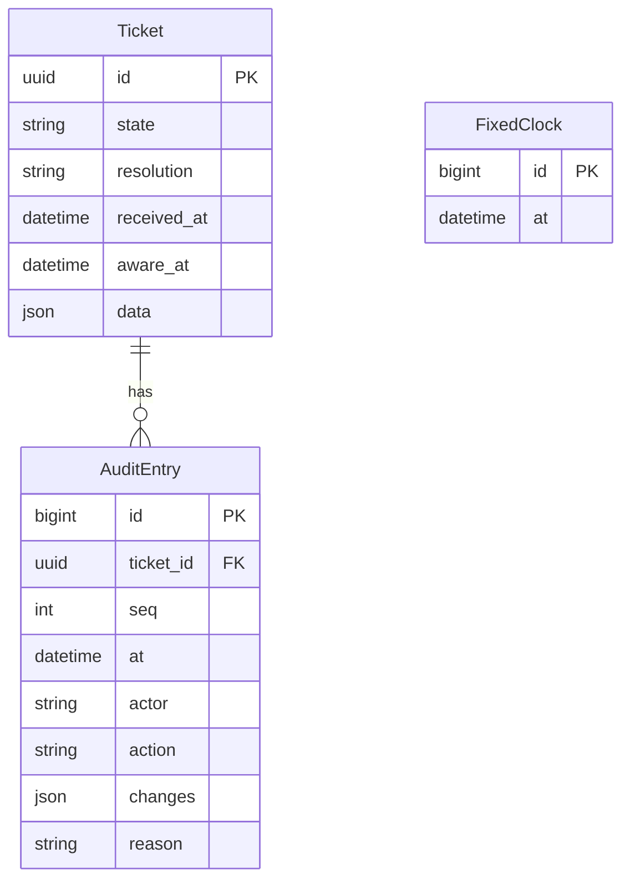
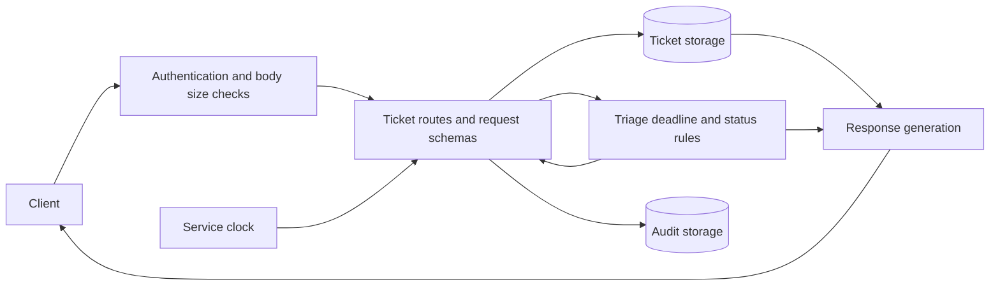

# Phase 3 integration and validation

This branch implements the Phase 2 Q6.1 ticket workflow through the common HTTP
interface. It integrates the domain work from PRs #5 and #6 with ticket storage,
request schemas, audit records, and response generation. It is a proposed increment
until reviewed, merged, and released. The existing README deployment URLs do not
prove that this branch is deployed.

## Delivered behavior on this branch

- REQ-01: create a ticket with a unique opaque ID, state `received`, and receipt
  time from the service clock.
- REQ-02/REQ-03: triage an actively exploited vulnerability as `reportable`, or
  close a non-reportable/invalid ticket with the corresponding resolution.
- REQ-04: calculate exact UTC deadlines, including fixes preceding awareness.
- Initial REQ-05 behavior: derive unsubmitted statuses on every read. No fix
  means `awaiting_fix`; the exact deadline remains `pending`.
- REQ-12/REQ-13: strict input validation, problem details, error precedence,
  timestamp normalization, and no stored changes after an error.
- REQ-14/REQ-16: reuse bearer authentication, actor validation, and persistent
  clock/reset controls. Deployment HTTPS enforcement needs a deployed-target run.

The increment also supports editable ticket details and awareness recalculation
from REQ-06, an unfiltered ordered ticket list, and read-only audit access.
These make the closed-ticket rejection and successful-change evidence observable.
The Phase 4 reporting workflow remains incomplete.

## Data and request flow

`core.models.Ticket` stores state, receipt/awareness times, and validated client
fields in a JSON column. `AuditEntry` stores per-ticket sequence, time, actor,
action, changes, and reason. Migration `0002_phase3_tickets` adds both tables;
the existing reset control clears them and preserves the fixed clock.



Ticket transitions implemented in this increment are `received` to `reportable`
and `received` to `closed` with a non-reportable resolution. Closing a reportable
ticket as `resolved` remains part of Phase 4; the full shared Model A is a
specification, not a claim that all of its transitions have been delivered.



Mutating requests use the existing request transaction. Triage and updates lock
the ticket row, validate before persistence, and add exactly one audit entry.
Reporter data appears only in single-ticket detail responses and is omitted from
audit changes and other ticket responses. Statuses and deadlines are derived,
not persisted independently. A PostgreSQL concurrency test checks that competing
triage requests produce one success, one conflict, and one triage audit entry.

## Common operation status

| Operation | Implemented on this branch | Limitations |
| --- | --- | --- |
| `GET /health` | Yes | Does not verify the database. |
| `POST /tickets` | Yes | Uses the common input schema. |
| `GET /tickets` | Partial | Ordered unfiltered list; filters remain Phase 4 work. |
| `GET /tickets/{id}` | Yes | Includes reporter details and initial obligation statuses. |
| `PATCH /tickets/{id}` | Yes for editable details | Submitted-content locking awaits the submission workflow. |
| `POST /tickets/{id}/triage` | Yes | Non-reportable decisions have no reporting awareness time. |
| `GET /tickets/{id}/reports/{type}` | No | Phase 4 drafts. |
| `POST /tickets/{id}/reports/{type}/submission` | No | Phase 4 submissions and content locking. |
| `POST /tickets/{id}/close` | No | Phase 4 resolution after all submissions. |
| `GET /tickets/{id}/audit` | Yes | Other methods return 405. |
| `POST /test/reset` | Yes | Clears all application data on the selected deployment. |
| `GET /test/clock` | Yes | Reads fixed or real time. |
| `PUT /test/clock` | Yes | Strict timestamp validation. |
| `DELETE /test/clock` | Yes | Releases the fixed clock. |

Success and documented error responses exercised by the acceptance suite are
validated against `openapi.yaml`. This does not claim conformance of operations
whose success behavior is not implemented, or verification of a deployed revision.

## Automated acceptance coverage

| Criterion | Shared test methods in `acceptance/cases.py` | Evidence |
| --- | --- | --- |
| AC-01 | `test_ac01_intake_has_unique_ids_and_fixed_receipt_time` | Two unique tickets, receipt time, initial state. |
| AC-02 | `test_ac02_invalid_intake_preserves_ticket_count`, `test_ac02_malformed_intake_preserves_ticket_count` | Missing/invalid fields, invalid JSON, body size, no new rows. |
| AC-03 | `test_ac03_model_d_exact_deadlines_and_statuses` | Exact Model D E1-E5 fixture results. |
| AC-04 | `test_ac04_rejected_triage_preserves_ticket`, `test_ac04_retriage_is_conflict_and_changes_nothing` | Missing awareness/reason, future awareness, repeat triage, unchanged ticket. |
| AC-05 | `test_ac05_closed_ticket_remains_readable_and_rejects_changes` | Both non-reportable decisions, no obligations, closed update rejection. |
| AC-14 | `test_ac14_timestamps_are_normalized`, `test_ac14_bad_timestamp_leaves_ticket_unchanged` | E7 offset, truncation, bad timestamp rejection. |
| AC-15 | `test_ac15_every_protected_operation_rejects_unauthorized_requests`, `test_ac15_missing_actor_changes_nothing`, public health and HTTP probe | Authentication across the whole contract; HTTPS probe only on deployed targets. |
| AC-17 | `test_ac17_reset_deletes_tickets`, `test_ac17_clock_stays_fixed_and_controls_receipt`, invalid clock case | Reset, two reads two seconds apart, fixed receipt, invalid clock rollback. |

The initial status boundary test adds the unsubmitted portion of AC-06. Local
integration tests also check audit privacy/counts, failed update rollback,
recalculation, out-of-range deadline rejection, and PostgreSQL row locking.
Expected dates come from Phase 2 Model D; status boundaries come from Model B.
Schema checks use the common OpenAPI file, not Ninja's generated documentation.

## Running the external suite

The ordinary `pytest -q` runs local regression tests, including the same acceptance
cases through Django's test client. The external suite has a separate configuration
and does not require Django settings or a database connection.

Set `CRA_API_TOKEN` locally to the selected deployment's access token, then run:

```powershell
.\.venv\Scripts\python.exe -m pytest -c acceptance/pytest.ini acceptance `
  --base-url https://your-coordinated-test-host `
  --allow-reset --tested-version YOUR_RELEASE_SHA `
  --report .venv/phase3-http-report.json -q
```

`CRA_BASE_URL` can replace `--base-url`; `CRA_TESTED_VERSION` can replace the version
option. The version is an operator-provided label, not automatic verification of
the Cloud Run image. The report records UTC run times, target, counts, durations,
test IDs, and outcomes, never the access token or request/response bodies.

Run serially and coordinate the reset window with the deployment owner and Team 21.
The suite requires explicit reset permission, resets before each case, and leaves
the last case's simulated data and fixed clock in place for inspection. It refuses
credential-bearing base URLs and uses HTTPS except for loopback development.
Authenticated requests never follow redirects. A loopback HTTP run skips the HTTPS
enforcement probe and cannot be used as evidence of deployed HTTPS compliance.

External HTTP tests exercise API, clock, ticket-state, and deadline components and
Models A/B/D behavior. They do not measure source-code coverage of another team's
service. Report that limit rather than inventing code coverage.

## Release and evidence still required

1. Team review of the API/data changes and the inherited domain PRs.
2. Merge through a PR, then use the existing deployment workflow for the selected
   environment. Record the actual deployed image SHA; do not substitute a local run.
3. Run the suite against that release and against Team 21 during coordinated windows.
4. Obtain Team 21's run against our service and classify any mismatches.
5. Update the actual class registry and Phase 3 report with release, test-run,
   operational-log, model, limitation, and GenAI evidence.

The standalone OpenAPI description omits some arithmetic specified in the Phase 2
report. Non-reportable triage with an optional awareness input is also underspecified.
This implementation uses the existing domain result's absent reporting awareness;
confirm any extra response/audit expectations with the pod. No shared contract
version or deployed-service registry has been changed by this branch.
