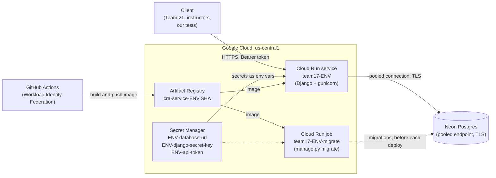

# Platform

This doc covers how the service is hosted, deployed, rolled back, and kept cheap, plus
the known limitations evaluators should expect. The API contract is
[`openapi.yaml`](../openapi.yaml). Local setup is in the [README](../README.md).

## Architecture



`ENV` is `dev` or `prod`. Each environment has its own copy of every box inside Google
Cloud, and its own Neon project.

| Component | What it does here |
|---|---|
| **Cloud Run** | Runs the Django container (gunicorn, 2 workers) as `team17-dev` and `team17-prod`. 1 vCPU, 512 MiB, request timeout 30 s, concurrency 80. Min 0 and max 1 instances. CPU is allocated only while a request is in flight (`--cpu-throttling`). Cloud Run terminates HTTPS. Ingress is public (`--allow-unauthenticated`) and the app itself enforces the bearer token. Each service runs as its own `ENV-runtime@` service account. |
| **Neon** | Postgres, one Neon project per environment. `DATABASE_URL` is the **pooled** connection string with `sslmode=require`. The pooler runs in transaction mode, so Django opens a connection per request (`conn_max_age=0`) and disables server-side cursors (`config/settings.py`). Reads skip the request transaction, and `GET /health` never opens a connection. |
| **Secret Manager** | Holds `ENV-database-url`, `ENV-django-secret-key`, and `ENV-api-token`. The deploy passes them to the service and migrate job with `--set-secrets ...:latest`. Cloud Run reads the value when an instance starts, so redeploy after rotating a secret. Nothing secret lives in the repo or in GitHub. |
| **Artifact Registry** | Docker repository `team17`. Images are `cra-service-dev` and `cra-service-prod`, each tagged with the commit SHA. The cleanup policy in [`deploy/cleanup.json`](../deploy/cleanup.json) keeps the 2 most recent images per environment and deletes any others older than 7 days. |
| **GitHub Actions + WIF** | The deploy job exchanges its GitHub OIDC token through Workload Identity Federation (`GCP_WIF_PROVIDER`) to act as the deployer service account (`GCP_DEPLOY_SA`). There are no service account keys. Only the deploy job gets `id-token: write`. |

GitHub repository variables (not secrets) used by the workflows:

| Variable | Use |
|---|---|
| `GCP_PROJECT_ID`, `GCP_REGION` | Target project and region. |
| `GCP_WIF_PROVIDER`, `GCP_DEPLOY_SA` | Keyless auth from Actions to Google Cloud. |
| `DEV_HOST`, `PROD_HOST` | The exact hostname Django accepts for Launchpad and Orbit (`ALLOWED_HOSTS`). Use the hostname from `gcloud run services describe team17-ENV --format='value(status.url)'`, without `https://`. |

## Deployments

| Nickname | Cloud Run service | Who uses it | How it deploys |
|---|---|---|---|
| **Launchpad** | `team17-dev` | The team, for development and our own test runs. | Automatically on every push to `main`, after tests pass (`ci.yml`). |
| **Orbit** | `team17-prod` | **The evaluation deployment.** Team 21 and the instructors test against it. Its URL (`https://` + `PROD_HOST`) is the one to publish in the shared pod file. | Manually only: Actions → **Launch to Orbit** → Run workflow on `main` → type `ORBIT` (`orbit.yml`). Other branches are refused. |

The current URLs are in the [README](../README.md#deployments). If a hostname ever
changes, update the repository variable and the README together.

The two deployments share nothing at runtime: separate Cloud Run services, Neon
projects, secrets, runtime service accounts, and image packages. Data written to
Launchpad never shows up on Orbit.

## How deploys work

Both environments go through the same steps: `test.yml`, then the reusable
`.github/workflows/deploy.yml`.

1. **Test.** Ruff lint and format check, `makemigrations --check`, `manage.py check`,
   and `pytest` against a Postgres 18 service container.
2. **Resolve the allowed host.** Picks `DEV_HOST` or `PROD_HOST`. If the variable is
   empty, the deploy stops here, before anything is built.
3. **Authenticate** to Google Cloud through Workload Identity Federation.
4. **Build and push** the image as `cra-service-ENV:<commit SHA>`.
5. **Migrate.** Points the Cloud Run job `team17-ENV-migrate` at the new image and runs
   `python manage.py migrate --noinput` with `--wait` (no retries, 5 minute timeout).
   If it fails, the deploy stops and the running service is untouched.
6. **Deploy** a new revision of `team17-ENV` with the new image, secrets, and
   `DJANGO_DEBUG=false,ALLOWED_HOSTS=<host>`. The new revision takes 100% of traffic as
   soon as it is ready, unless traffic is pinned (see [Rolling back](#rolling-back)).
7. **Smoke test.** `GET /health` on the service URL, up to 10 tries 5 seconds apart. The
   URL Cloud Run reports is the same hostname as `DEV_HOST`/`PROD_HOST`, so a wrong host
   variable fails here with a 400. This step runs after traffic has moved, so if it
   fails, the broken revision is already serving. Roll back.

Only one deploy per environment runs at a time, and a running deploy is never
cancelled. GitHub keeps at most one waiting run per environment, so a newer run
replaces an older one that is still waiting.

### Migrations

- Migrations never run at container startup. They run only in the migrate job, before
  the new revision is deployed.
- For a short window, the **old** revision serves requests against the **new** schema.
  Every migration therefore has to work with the code from the previous release: add
  tables and nullable columns first, and drop or rename only in a later release.
- Django applies each migration in its own transaction on Postgres. If one fails, that
  migration is rolled back, but earlier ones from the same run stay applied.
- To see what happened in a migrate run:
  `gcloud run jobs executions list --job team17-ENV-migrate --region us-central1`,
  then open the execution's logs in the Cloud Console.

## Rolling back

Cloud Run keeps every revision. Rolling back means sending all traffic to an earlier
one. It takes seconds and doesn't rebuild anything.

```bash
SERVICE=team17-prod          # or team17-dev
REGION=us-central1

# 1. Find the last good revision (newest first).
gcloud run revisions list --service "$SERVICE" --region "$REGION"

# 2. Send all traffic to it.
gcloud run services update-traffic "$SERVICE" --region "$REGION" \
  --to-revisions REVISION_NAME=100

# 3. Confirm. Use PROD_HOST or DEV_HOST from the repository variables.
curl -fsS "https://$HOST/health"
```

Before you rely on a rollback, check the following.

- **Traffic stays pinned.** After step 2, new deploys still create revisions, but those
  revisions get **no traffic**. The deploy's smoke test still passes because it reaches
  the pinned old revision. Once the fix is merged and deployed, run:

  ```bash
  gcloud run services update-traffic "$SERVICE" --region "$REGION" --to-latest
  ```

  Don't run this before the fix is deployed: until then, the latest revision is the
  broken one.
- **The database is not rolled back.** The old revision runs against the current schema.
  That works if the migration followed the backward-compatibility rule above. If it
  didn't, reverse the migration with the migrate job, which still holds the newer
  image that contains the migration files:

  ```bash
  gcloud run jobs execute "$SERVICE-migrate" --region "$REGION" --wait \
    --args="manage.py,migrate,core,<last good migration>,--noinput"
  ```

  Reversing a migration that dropped data does not bring the data back.
- **Old images expire.** The cleanup policy keeps only the 2 most recent images per
  environment, so the previous deploy is normally still available. For anything older,
  check that the revision's image still exists before relying on it:

  ```bash
  IMAGE=$(gcloud run revisions describe REVISION_NAME --region "$REGION" \
    --format='value(spec.containers[0].image)')
  gcloud artifacts docker images describe "$IMAGE"
  ```

- **A revert keeps `main` and Orbit in sync.** For a lasting fix, revert the bad commit
  on `main`. Launchpad redeploys automatically. Then launch to Orbit and run
  `--to-latest` if traffic was pinned. For Orbit, the usual sequence is: pin traffic
  first (fast), then revert, redeploy, and unpin.

## Cost controls

| Control | Setting |
|---|---|
| **Max 1 instance** | `--max-instances 1` on both services, so Cloud Run never scales out. |
| **Scale to zero** | `--min-instances 0` and `--cpu-throttling`: no instance runs while idle, and CPU is billed only while a request is in flight. |
| **$10 Cloud Run spend cap** | If Cloud Run spend reaches $10, the cap stops serving. It does not reset on its own, so someone has to lift it manually (see [Known limitations](#known-limitations)). |
| **$1 alert budget** | A budget alert fires at $1 of spend, long before the cap. |
| **Image cleanup** | Artifact Registry keeps 2 images per environment and deletes others after 7 days. |
| **Neon stays asleep** | `GET /health` and the deploy smoke test never touch the database, so health checks don't keep Neon's compute running. |

## Known limitations

- **Cold start.** With min instances 0, the first request after a period of idle takes
  a few seconds while Cloud Run starts an instance. The first database query after idle
  can add more time if Neon's compute has also suspended.
- **Single instance, shared state.** Each deployment is one instance and one database,
  and every client shares it: the same tickets, the same fixed clock, the same reset.
  - Run test suites **serially**, one at a time per deployment. Before running against
    Orbit, coordinate with Team 21 and the instructors.
  - `POST /test/reset` clears **everything**: every ticket, report, and audit entry, for
    every client. It does **not** release a fixed clock. Call `DELETE /test/clock` for
    real time.
  - Throughput is low: 2 gunicorn workers on one instance handle 2 requests at a time,
    and the rest wait in a queue. Any request that takes longer than 30 seconds times
    out.
- **`/health` doesn't check the database.** A 200 means the container is up and Django
  loaded. It doesn't mean Neon is reachable or migrations are applied. The deploy smoke
  test has the same limit.
- **The spend cap stops Orbit.** If the $10 Cloud Run cap ever triggers, Orbit stops
  serving until someone lifts the cap manually.
- **One hostname per service.** Django accepts only the hostname in `DEV_HOST`/
  `PROD_HOST`. Cloud Run also gives each service a second URL of the form
  `https://team17-ENV-<project number>.us-central1.run.app`. That URL reaches the same
  service but gets a 400. Share only the `status.url` hostname. A new hostname (a custom
  domain, a recreated service) needs the repository variable updated and a redeploy.
- **Open interpretations of `openapi.yaml`.** Where the contract is silent or ambiguous,
  the service behaves as follows:

  | Question | What the service does |
  |---|---|
  | Does reset release a fixed clock? | No. Reset deletes tickets, reports, and audit entries only. |
  | Where does 405 fit in the error precedence? | After 401. With a valid token, a wrong method returns 405 even for an unknown ticket ID (`PUT /tickets/{unknown}/audit` → 405, not 404). |
  | Does 413 apply to routes without a request body? | Yes, to every request, including `/close`, `/test/reset`, and `GET /health`. |
  | Which requests are public? | Only `GET /health`, read literally. `HEAD /health`, `/docs`, `/openapi.json`, and `/admin/` all need the token, so `HEAD`-based uptime checks get 401. |
  | Path parameter that fails validation? | 404, matching "unknown types return 404". |
  | Whitespace-only `X-Actor`? | Treated as empty (400). The value is stripped. |
  | Timestamp edge cases? | Lowercase `t`/`z` and `-00:00` are accepted. A space separator, the leap second `:60`, and values that overflow when converted to UTC return 400. Fractional seconds are truncated, never rounded. |
  | How is `errors[].field` written? | A dotted path with `[n]` for list items (`product.affected_versions[1]`). Whole-body and JSON errors use `body`, the header uses `X-Actor`, and query errors use the parameter name. |
  | Body sent to a route that defines none? | Ignored, not rejected. |
  | Chunked body with no `Content-Length`? | Not supported. It is treated as absent (400 `required`), not checked against the 413 limit. |
  | Which server URL? | The `servers` entries in `openapi.yaml` are placeholders. The real Orbit URL is `https://` + `PROD_HOST`, and it belongs in the shared pod file. |
